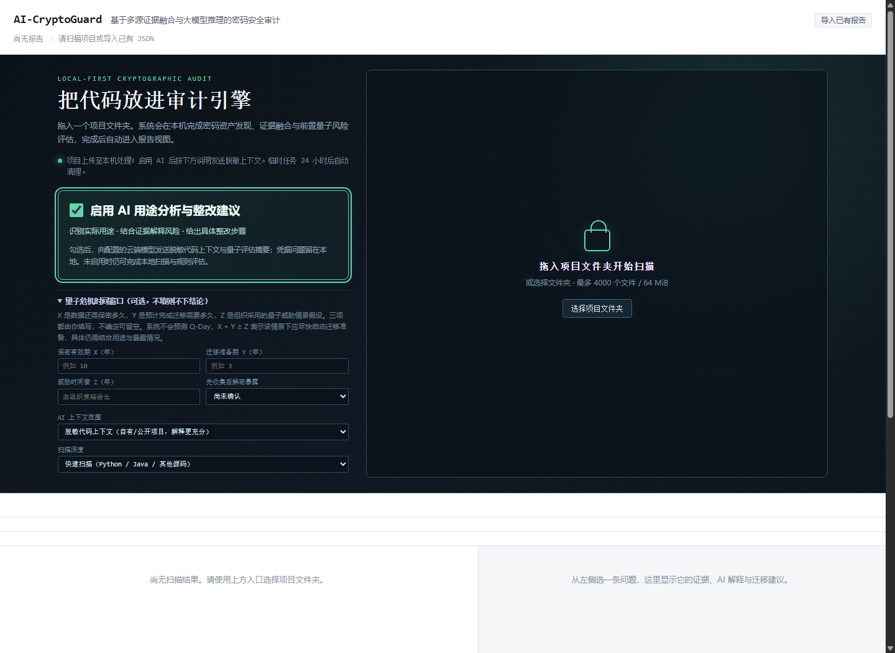
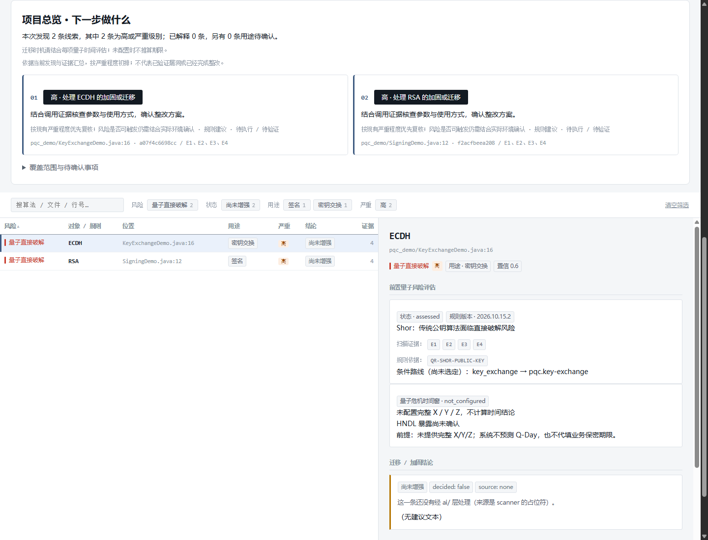

# AI-CryptoGuard 作品设计报告

> 附件二正文内容源。以官方模板生成 DOCX；作品编号由提交人补填。截图采用公开演示源码，正文不含团队身份。测试数字引用注明日期的实测记录，不将历史实验冒充当前提交全量重测。

## 1. 作品功能及性能说明

### 1.1 设计目标与应用场景

AI-CryptoGuard 是面向开发者和代码审计人员的本地优先密码安全审计与抗量子迁移辅助系统。用户选择源码项目后，系统完成密码资产发现、凭据检查、证据融合和量子风险评估；用户可进一步启用 AI，得到实际用途解释、风险依据、待确认事项与具体整改步骤，最终形成中文审计报告。

作品解决三个实际问题。第一，多个扫描工具的算法名称、位置和风险分类不一致，直接汇总容易重复或相互矛盾。第二，检测到密码算法不等于知道它的业务用途；同为公钥密码，签名与密钥交换的迁移路线不同。第三，传统扫描结果往往只有问题名称和位置，缺少开发者可以执行的核查与整改步骤。系统通过“证据归一化—确定性规则评估—受证据约束的 AI 解释”连接检测结果与后续行动。

软件主要用于源码提交前审计、存量项目密码资产梳理及后量子迁移准备。界面运行于本机浏览器；源码扫描和规则计算在本机完成，云模型解释是用户主动启用的功能。系统提供审计辅助结论，不替代人工安全评审，也不把静态发现直接认定为可利用漏洞。

### 1.2 功能组成

| 功能 | 输入与输出 | 适用范围 |
|---|---|---|
| 项目接入与任务管理 | 文件夹输入；阶段进度、完成或失败原因 | Web 单任务最多 4,000 文件、64 MiB 源码；面向本机使用 |
| 多源快速扫描 | 源码、局部配置；统一发现与证据 | Python、Java 为主要演示语言，其他源码按扫描器支持范围处理 |
| 本地补充检测 | AST、常量与敏感语境；凭据和部分误用发现 | 局部规则，不等于完整跨过程分析 |
| Java 深度分析 | 源码和对应编译产物；可定位深度证据 | 可选，需外部 CrySentry 和 JDK 17；不适用于 Python |
| 量子风险与迁移评估 | 算法、用途证据和可选时间情景；风险与条件路线 | 密码事实由规则库给出，用途未知时保留候选条件 |
| AI 用途解释与整改 | 脱敏上下文、证据及前置评估；中文解释与步骤 | 显式开启；解释必须引用现有证据，凭据类问题本地处理 |
| 行动清单与报告 | 统一结果；优先复核列表、证据详情、自包含 HTML | 同一来源生成网页和报告，避免两端结论分叉 |
| 候选修复与复扫 | 受支持的 Python 代码；补丁及前后验证 | 仅在临时副本处理，不自动修改或部署用户项目 |

### 1.3 性能目标与评价方式

设计目标包括较高的查准率与召回率、可追溯的解释、可接受的本地扫描时间和清晰的数据处理边界。查准率与召回率分别按 TP/(TP+FP)、TP/(TP+FN) 计算，不以“生成了多少条结果”代替检测效果。初期计划中的 P≥85%、R≥90% 和本地平均扫描不超过 30 秒作为验证目标；第 3 节分别给出已取得的开发集结果、外部专项诊断和性能测量，不将其概括为任意项目的保证。

## 2. 设计及实现方案

### 2.1 总体架构与软件流程

系统由扫描适配层、统一证据层、本地评估层、AI 解释层、报告交互层及修复验证模块组成。统一命令行入口与 Web 任务服务调用同一处理流水线。作品为软件系统，不依赖专用密码硬件；普通计算机提供计算和存储，Java 深度模式另准备 JDK 17。

```text
项目文件夹 ─→ 快速扫描／AST／凭据规则 ──────────┐
                                             ↓
Java 源码＋对应 jar ─→ 可选 CrySentry ─→ 归一化与证据融合
                                             ↓
                                  本地量子风险与时间情景评估
                                             ↓
                                可选 AI 用途解释与整改步骤
                                             ↓
                              项目总览／证据详情／中文报告
                                             ↓
                         受支持场景：临时副本候选修复与复扫
```

任务记录 scan、deep_java、quantum_assessment、ai 等阶段的状态。缺少工具、超时或分析失败有独立状态和原因；不把未运行的阶段写成“未发现问题”。Java 深扫或 AI 失败时仍保留快速扫描与本地规则结果。AI 可独立重试，避免重复上传和重跑已完成阶段。

### 2.2 统一证据与保守融合

采用版本化 Finding/Task 契约连接各模块。发现记录保存稳定标识、项目相对文件、行号、算法或规则标识、用途、风险及 evidence 数组。算法发现按文件、归一化算法与用途等信息匹配，融合时保留来源和位置；名称相近但缺乏同一性证据的发现不强行合并。凭据问题单独标为 credential，不把口令泄露误写成密码算法或量子风险。

证据编号 E1、E2 等仅表示本条发现中的 evidence[0]、evidence[1]，不是全局编号。规则引用与证据引用分开保存：规则说明判断依据，证据说明该项目中观察到了什么。程序验证编号范围、字段类型、阶段约束和输入摘要；这些校验能阻止越界引用与过期结果复用，但不能独自证明解释语义正确。

Java 深度输出由本项目的 runner 与 adapter 调用和转换。只有能可靠定位到源码的记录才附加到发现；无法映射的记录进入未解决区。工具只提供来源和汇点时标为 partial，缺少来源则标 source_missing，界面不补造中间传播路径。深扫没有报出某问题，不自动推翻快扫结果；分支可达性仍需按工具证据范围判断。

### 2.3 本地检测与凭据保护

在第三方快扫之外，系统实现部分 Python AST、常量关联与凭据规则。AST 用于识别真实调用或赋值，减少将注释、字符串中的算法名称视为实际执行的情况；其覆盖仍受语法、别名、动态加载和跨函数传播限制。

| 凭据规则方向 | 主要触发依据 |
|---|---|
| 硬编码口令 | 敏感变量或参数接收口令字面量 |
| 硬编码 API Key／Token／Secret | 敏感角色与静态材料共同出现 |
| 硬编码密码学密钥 | 密钥材料及密码 API 语境 |
| 内嵌私钥 | 私钥材料格式特征 |
| URL／连接串含凭据 | 认证信息进入地址或连接字段 |
| 凭据进入日志 | 日志或输出调用关联敏感变量 |
| 默认或弱口令 | 口令语境和弱值规则 |
| 高熵秘密 | 敏感语境、长度与熵联合判断 |

上表是八个规则方向，部分条件存在交叠，不据此声称八个互斥类别均达到相同准确率。凭据原文不写入发现、日志或报告，只保存遮蔽提示及进程内随机密钥计算的 HMAC 指纹。指纹用于该扫描中的关联，密钥不落盘；凭据类发现不发送云模型。

### 2.4 量子风险与用途约束的迁移决策

量子评估安排在扫描之后、AI 解释之前。系统分别记录经典安全问题与量子影响，避免把所有弱算法归为“Shor 可破解”。公钥密码的 Shor 风险、对称原语的量子搜索影响、已知经典弱点和证据不足分别处理；未知参数不以默认值替代。风险名称是类别提示，具体影响仍依赖参数、使用方式和威胁假设。

迁移路线依据实际用途选择：签名场景参考 ML-DSA、SLH-DSA 等签名路线，密钥建立参考 ML-KEM 路线；加密场景还需结合对称加密和协议设计。规则过滤原语与用途不相容的候选。仅看见 RSA/ECC 名称而不知道用途时，保留条件候选和缺失信息，不直接给出固定替换算法。AI 提供用途解释后，由本地规则复核路线相容性，最终算法选择不由模型自由生成。

用户可提供 X（数据还需保密多久）、Y（完成迁移准备需要多久）、Z（组织采用的量子威胁时间窗）。当 X+Y≥Z 时，系统提示该情景下应尽快准备迁移；否则以 Z−X−Y 表示情景中的准备余量。参数不完整则不下时间结论。这里的 Z 是用户假设，不是系统预测 Q-Day。先收集后解密（HNDL）还需结合加密或协商用途与暴露条件，签名场景不直接套用密文 HNDL 判断。

### 2.5 受证据约束的 AI 解释

AI 承担“将发现转化为人能理解并执行的审计建议”的角色。输入包括算法或规则、可引用证据、经脱敏的代码上下文、前置量子评估及未知项；输出包括 usage_assessment、中文 explanation、evidence_refs 和 remediation_steps。步骤保存行动、目标位置、前置条件、验证方法和未执行状态，避免把生成建议误写为已完成修复。

提示词明确标注证据编号，要求模型逐项引用。解释之后进行结构和跨字段验证：引用必须存在于当前发现，规则引用必须属于允许范围，用途不能与原语冲突；输入、规则、提示词、模型配置和脱敏版本共同参与缓存复用判断。超时或解析失败保留本地结果，已完成项支持续跑。

系统区分“创建对象”和“实际使用”。例如 Cipher.getInstance 只说明构造了密码对象，不能独自证明加密用途；同一对象存在 init(ENCRYPT_MODE) 证据时才能支持加密配置解释，仍不能推出实际执行了 doFinal 或业务影响。真实 Java 单例验证中，补入调用模式与行号后模型输出 encryption 并引用 E1/E3/E4，说明补充上下文比要求模型猜测更有价值。

云 AI 默认关闭。full 模式发送脱敏代码上下文，shape 模式仅保留 API 调用形状；均经过白名单字段筛选与敏感内容处理。证据不足时保留 unknown 并说明需要核查的内容。程序层引用有效并不保证句子被证据支持，语义效果须由独立人工审阅另行评价。

### 2.6 修复验证与运行效果

当前候选修复覆盖三类受限 Python 形态：非协议、非口令用途的 MD5 调用替换候选；安全用途变量上的弱随机字节生成；硬编码口令转为环境变量读取。通过 AST 定位，在临时副本中应用补丁，执行语法检查、正式扫描器复扫，并在用户显式选择可信项目时运行项目测试。协议指定的 MD5、口令摘要迁移、名称被重绑定或语义无法确认的代码保持不自动修改。临时副本不是操作系统沙箱。

Web 将 AI 分析作为突出且需主动选择的功能，将上下文范围和扫描深度作为辅助选项。项目上传与扫描进度共用右侧区域，完成后呈现项目行动清单、风险列表和证据详情。行动清单由已验证的发现和步骤生成，按严重程度及条件标记排列；“待执行／待验证”保持可见。离线 HTML 使用同一结果来源，可在没有任务服务时查看。





图 1 的勾选状态用于展示可选 AI 功能，不表示已经发生云调用。图 2 是公开演示项目的本地扫描结果，显示 RSA 签名与 ECDH 密钥交换两条发现及各自证据。该截图用于证明交互与结果展示，不计入独立检测成绩或模型语义正确率。

### 2.7 自主实现与第三方能力边界

作品自主实现的重点是异构输出适配、证据归一化与保守融合、本地补充规则、用途约束的量子评估、AI 输入输出约束、评测适配与匿名化、统一任务入口、中文交互报告和受限修复验证。创新体现在检测证据到决策解释的工程闭环，不宣称提出新的密码算法或独立开发了底层程序分析引擎。

CryptoScan、cbom-scan 与 CrySentry/Tai-e 的原始扫描能力归原作者。系统通过外部进程调用；提交源码不附带这些工具的完整源码、可执行文件、fatJar 或 JDK。第三方来源与许可清单单独保留，引用公开基准时同样保留出处，不把其样本与标签表述为自建数据。

## 3. 系统测试分析

### 3.1 测试方案与复现原则

测试分为功能回归、公开开发集评测、外部首次专项诊断、运行时间测量和端到端操作验证。开发语料包含 CryptoAPI-Bench、CamBench_Cap 与 LLM-CMT 的可用部分；四个来源累计生成 1,411 条派生标签，但标签总数不等于每次有效评分分母，未取得或不可对齐的样本不计作已完成测试。

范围、标签和匹配单位在评分前定义：开发算法发现按文件与算法匹配，凭据发现按文件与基准的宽泛类别匹配；单独的文件级或片段级实验另表报告。范围内困难样本保留。超时、失败、跳过进入任务状态，不作零发现计分。评测匿名化替换泄漏答案的目录、文件和标识符名称，保留真正的代码字面量；私有映射不提供给模型。

先冻结输入和标签、再运行的结果记录为首次诊断；看过错例后在原集上的优化结果记录为同集回归，不能重新称为独立成绩。以下检测指标引用 2026 年 10 月 18—19 日已保存的实验记录。10 月 19 日后公开 ECDH 样例去重与界面优化有定点回归，但没有据此将旧总表标为最新提交的全量重测。

### 3.2 功能测试与异常处理

| 测试内容 | 已取得的结果 | 解释边界 |
|---|---|---|
| 契约和证据校验 | 有效夹具通过；非法状态和越界引用被拒绝 | 结构正确不等于语义正确 |
| 凭据输出保护 | 合成凭据八类触发、ID 稳定、指纹变化；输出不含合成原文 | 不证明所有真实格式均可识别 |
| Java 深度集成 | 公开样例实际运行；源码定位与失败回退有检查 | 仅首尾证据时保持 partial，不宣称完整传播链 |
| AI 结构回归 | 固定公开批次 44/44 解释完成、0 最终结构错误 | 29 条算法调用模型，15 条凭据本地处理；人工语义审阅尚未完成 |
| 项目总览与 Web | 行动清单引用、HTML 转义、AI 部分失败反馈和单独重试通过 | 任务内存状态不支持服务重启后自动恢复 |
| 上传与布局 | 并发上传失败不被后续成功覆盖；重复入口受控；桌面及窄屏检查通过 | 不属于检测 P/R 或高并发服务压力测试 |
| 候选修复 | 三类合成形态语法检查与正式复扫通过；自建项目测试通过 | 行为兼容性仍须按项目确认 |

AI 结构回归的 29 条算法用途分布为 unknown 24、hashing 4、tls_configuration 1。大量 unknown 表明当前证据和门控较保守，不能据此说模型已经理解全部业务。该批次尚无独立人工语义通过率，因此报告不提供“AI 准确率”。真实调用单例与结构自检也不混入检测器的 TP/FP/FN。

### 3.3 检测效果与外部诊断

| 数据与实验属性 | 计数单位 | TP / FP / FN | P / R |
|---|---|---|---|
| 三套公开开发语料同集复扫 | 项目冻结的算法／凭据口径 | 620 / 103 / 62 | 85.8% / 90.9% |
| 10 月 14 日凭据专项开发记录 | 文件与宽泛凭据类别 | 165 / 73 / 57 | 69.3% / 74.3% |
| OWASP Java 首次外部诊断 | 482 文件，文件级 | 219 / 27 / 40 | 89.0% / 84.6% |
| OWASP Python 弱哈希首次诊断 | 151 文件，弱哈希文件级 | 37 / 0 / 34 | 100.0% / 52.1% |
| ProwlBench 凭据首次诊断 | 9,732 片段，秘密存在性二分类 | 1,570 / 201 / 5,123 | 88.65% / 23.46% |
| CCA-Droid 弱随机密钥首次深扫 | 7 文件，单一规则 | 4 / 1 / 1 | 80.0% / 80.0% |

开发集同集复扫达到初期 P/R 数值目标，但没有与之相同单位、未参与调参的完整独立留出总成绩。凭据专项和外部 Python、ProwlBench 首测召回较低，说明动态构造、跨函数传播、秘密格式及标签定义差异仍影响覆盖。不能将不同实验的最佳结果合并为一个总分。

深扫收益取决于任务：固定 25 个 Java 匿名样本的历史同题对照中，快扫和深扫均为 14/4/2；后续版本重跑均为 14/5/2，没有在该集合提升 P/R。CCA-Droid 的 7 文件弱随机密钥首次对照中，快扫为 0/0/5，深扫新增 4 个真阳性，同时产生 1 个不可达分支误报。修正来源定位后同集回归为 5/1/0，这只证明已知错例回归，不替换首次结果。

CryParBench/JobX 的历史项目仅提供 14 个已知参数型误用正标签；首次快速扫描同调用点命中 2 个，修正后原集回归命中 4 个。缺少完整负标签，不能计算完整 Precision。该实验进一步说明“识别到了算法”不等于“识别到了参数误用”，工具报告和基准真值必须按同一语义对齐。

### 3.4 性能测试

固定测量环境为 Windows 11、AMD Ryzen 9 8945HX、31.8 GiB 内存、Python 3.11.9、Node.js 24.13.0，外部工具为 CryptoScan 1.4.0 与固定 cbom-scan checkout。计时为新 Python 进程从启动到退出的墙钟时间，包含快扫、量子评估与写出，不包含深扫、项目编译和云端 AI。未控制系统缓存及后台负载。

| 输入 | 源码规模 | 测量次数与耗时 | 平均耗时 |
|---|---|---|---|
| CryptoAPI-Bench | 203 个 Java 文件 | 3 次：10.99、7.35、7.42 秒 | 8.59 秒 |
| CamBench，重复校验优化前 | 623 个 Java 文件 | 2 次：49.95、32.80 秒 | 41.38 秒 |
| 同一 CamBench，优化后回归 | 同上 | 2 次：23.26、21.99 秒 | 22.63 秒 |

优化将同一进程中反复加载的 Schema 校验器和量子规则缓存，未放宽逐条校验；固定输入重算的 assessed 结果逐项一致。该样本平均耗时下降并低于 30 秒，但测试次数少、机器性能较高，不能推出任意中小项目均满足此时限。深扫和 AI 耗时单列，受编译规模、可达方法数、网络和服务端响应影响。

### 3.5 修复验证、部署与测试结论

修复验证同时保留正向与反向案例。Chimera 的 nonce 案例在临时副本中修复后，正式扫描器不再报告对应问题；同一上游模块的 45 条测试在补丁前后均通过。这是单模块验证，不是全项目或真实协议验证。Requests 的协议 MD5、口令哈希场景以及口令文件名被识别为不应机械改写的反例，保持源码不变，避免通过“替换字符串”制造表面修复。

干净 Linux 环境已分别验证快速扫描／Web 与 Java 深扫，本机公开样例已串通 Java 深扫、量子评估、真实模型解释和报告。另一台机器上这四项同环境全链仍缺少完整证据。部署需要单独配置外部扫描器；AI 需要用户自己的模型配置，源码仓库不包含密钥或测试源码全集。

综合测试表明系统已具备可操作的审计与解释闭环，并能明确呈现阶段失败和证据不足；尚不能声称全语言、全缺陷类型或独立泛化均已达标。后续优先补充同口径独立留出集、逐类凭据真值、模型解释人工审阅，以及更充分的真实项目兼容性测试。

## 4. 应用前景

本地优先部署适合不便将完整代码交由外部服务的开发团队；关闭 AI 时仍可使用扫描、规则评估和报告，允许发送脱敏片段时再启用解释。统一证据结构有利于接入更多分析工具，并将“为什么报告此问题、依据是什么、下一步做什么”交给维护者核验。

抗量子迁移需要先理解资产和用途，再评估协议、证书、性能及生命周期。系统可作为迁移准备阶段的辅助工具，把算法清单转换为用途约束的候选路线和行动列表。其时间情景帮助组织讨论迁移优先级，不能代替组织自身的风险政策或标准符合性认证。

后续工作包括加强跨过程分析、改善凭据召回、建立独立语义评价集和增补协议级回归测试；产品侧可扩展任务持久化及团队审阅流程。当前版本专注单机审计，不宣称具备多租户隔离或互联网公开服务的完整安全能力。

## 5. 结论

本作品将多源检测、可追溯证据、本地量子评估、受约束 AI 解释与候选修复验证组织为统一的软件系统。与直接拼接扫描输出相比，核心价值在于保持证据来源、区分确定事实与条件判断、让用途影响迁移路线，并把结果转化为可检查的行动清单。

现有公开开发集与分项实验证明了系统在所测范围内的可运行性和部分检测效果；外部首测也揭示了凭据、参数误用和跨过程场景的不足。报告保留这些限制，区分结构有效、语义正确和行为兼容三个不同层次，作为继续完善检测和解释能力的依据。

## 参考资料与第三方来源

1. NIST FIPS 203：Module-Lattice-Based Key-Encapsulation Mechanism Standard；FIPS 204：Module-Lattice-Based Digital Signature Standard；FIPS 205：Stateless Hash-Based Digital Signature Standard。用于区分密钥封装与签名迁移方向。
2. CryptoScan：github.com/csnp/cryptoscan；cbom-scan：github.com/thefinalmilkman/cbom-scan；CrySentry：github.com/pascal-lab/CrySentry。用于外部快速扫描与 Java 程序分析。
3. CryptoAPI-Bench：github.com/CryptoAPI-Bench/CryptoAPI-Bench；CamBench：github.com/CROSSINGTUD/CamBench；LLM-CMT：github.com/ufooooy/LLM-CMT。用于本地开发评测，原始数据不随作品源码分发。
4. 外部专项测试使用 OWASP、ProwlBench、CCA-Droid 与 CryParBench/JobX 的已冻结样本。各自标签定义、版本及复现记录保存在测试支撑材料中，分开报告首次结果与回归结果。
